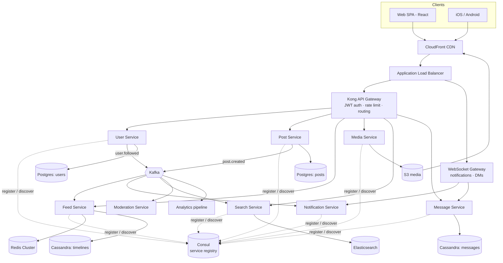
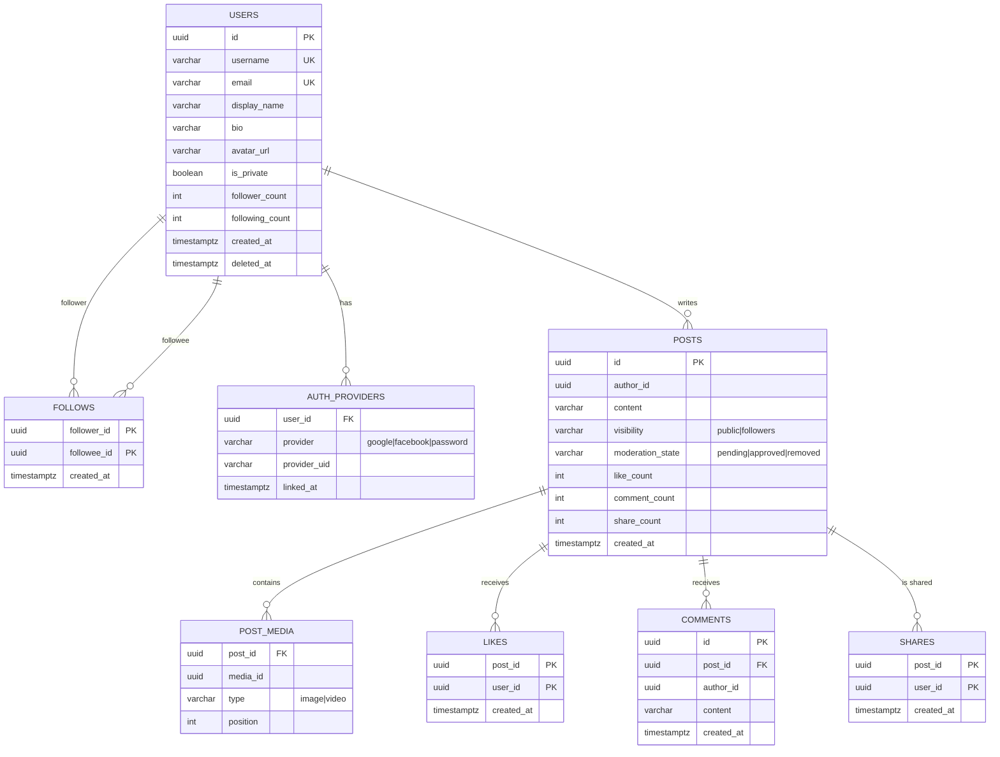
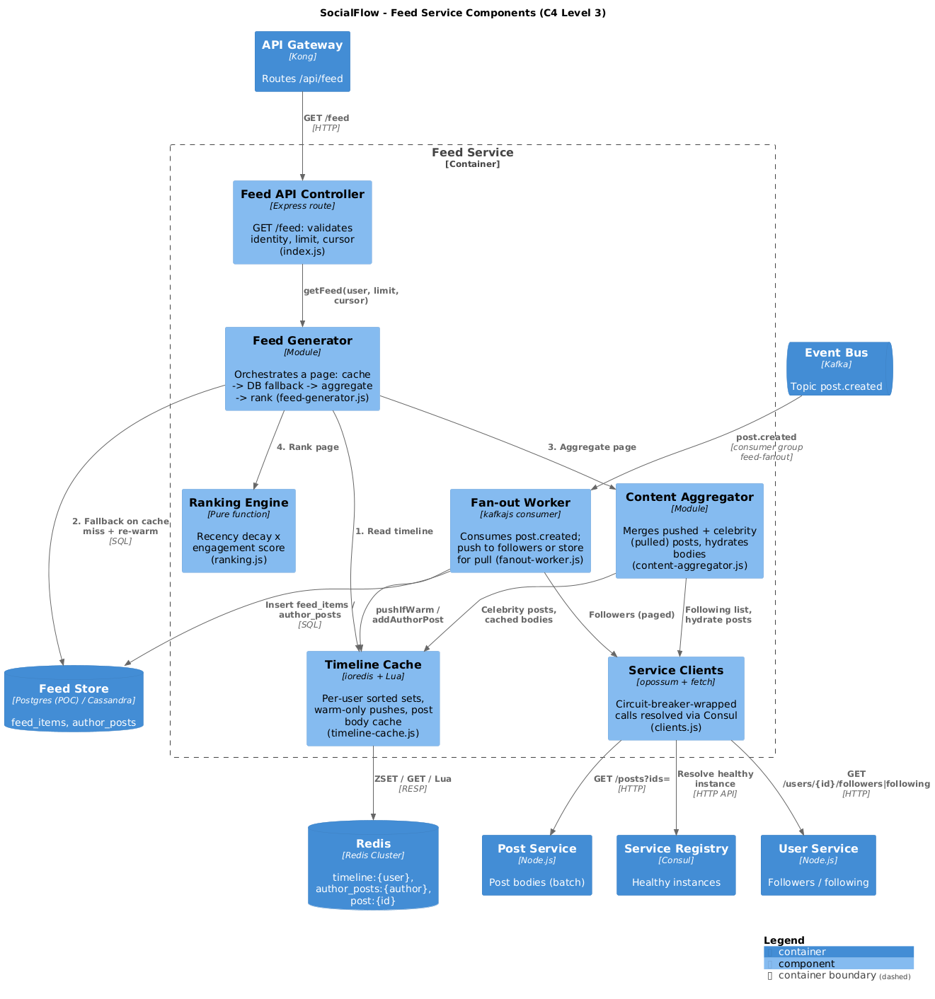
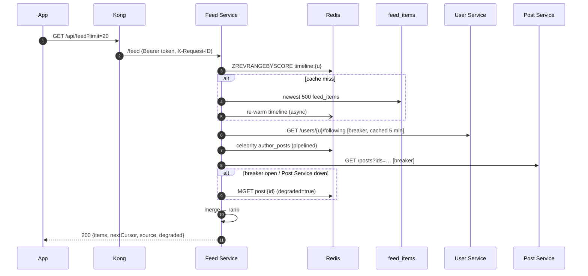

# SocialFlow — System Design Document

| | |
|---|---|
| **Author** | Lakshitha Wijerathne |
| **Programme** | Engineer Track — Month 6 Capstone |
| **Date** | 2026-10-29 |
| **Status** | Proposed (POC implemented) |
| **Related** | [C4 diagrams](c4/) · [ADRs](adr/) · [POC code](../services/) · [Challenge brief](01-challenge-brief.md) |

---

## Table of Contents

1. [Problem Statement](#1-problem-statement)
2. [Requirements](#2-requirements)
3. [Capacity Estimation](#3-capacity-estimation)
4. [High-Level Architecture](#4-high-level-architecture)
5. [Service Catalogue](#5-service-catalogue)
6. [API Design](#6-api-design)
7. [Data Model](#7-data-model)
8. [Deep Dive: Feed Service](#8-deep-dive-feed-service)
9. [Key Flows](#9-key-flows)
10. [Scalability Strategy](#10-scalability-strategy)
11. [Reliability & Availability](#11-reliability--availability)
12. [Consistency & CAP Choices](#12-consistency--cap-choices)
13. [Security & GDPR](#13-security--gdpr)
14. [Observability](#14-observability)
15. [Deployment Topology](#15-deployment-topology)
16. [Trade-offs & Alternatives](#16-trade-offs--alternatives)
17. [Scaling to 10×](#17-scaling-to-10)
18. [POC Scope & Mapping](#18-poc-scope--mapping)
19. [Risks & Open Questions](#19-risks--open-questions)

---

## 1. Problem Statement

SocialFlow is a mobile-first social network: people publish posts (text, images, video), follow each other, read a personalised home feed, react (like/comment/share), get real-time notifications and exchange direct messages. The platform starts at **1M MAU**, grows **50% year over year**, and must stay **99.9% available** with a **< 200 ms feed** and **< 500 ms post publish**.

The core engineering problem is the **read-heavy, fan-out-heavy home feed**: every post must reach every follower's timeline quickly, but a handful of accounts have orders of magnitude more followers than everyone else. Everything else (messaging, notifications, search, moderation) is designed so it can fail or lag without breaking feed reads and post writes.

## 2. Requirements

### 2.1 Functional

| # | Requirement | Owning service | In POC |
|---|---|---|---|
| F1 | Registration & authentication (email + Google/Facebook OAuth) | User / Identity | Registration only |
| F2 | Profile management | User | ✅ |
| F3 | Post creation — text, images, video | Post (+ Media) | Text + media URLs |
| F4 | Personalised news feed | Feed | ✅ |
| F5 | Follow / unfollow | User | ✅ |
| F6 | Like, comment, share | Post (interactions) | Like |
| F7 | Real-time notifications | Notification | — |
| F8 | Direct messaging | Message | — |
| F9 | Search (people, posts, hashtags) | Search | — |
| F10 | Content moderation | Moderation | — |

### 2.2 Non-Functional

| Requirement | Target | How it is met |
|---|---|---|
| Feed load time | **p95 < 200 ms** server-side | Pre-computed timelines in Redis; batch hydration; no fan-out on read for normal users (§8) |
| Post publish time | **p95 < 500 ms** | Single-row insert + outbox in one transaction; fan-out is asynchronous via Kafka; media uploaded beforehand via presigned URL (§9.1) |
| Concurrency | 100K concurrent users | Stateless services behind ALB + HPA; WebSocket gateway sized for 100K connections (§10) |
| Availability | 99.9% (≈ 43 min/month) | Multi-AZ everything, no single points of failure, circuit breakers, graceful degradation (§11) |
| Durability | No data loss | Postgres sync replica + PITR; Kafka RF=3, `acks=all`; transactional outbox; S3 11×9s (§11) |
| GDPR | Compliant | Data export & erasure workflows, crypto-shredding, EU data residency, consent (§13) |
| Mobile-first | Native apps first | Cursor pagination, compact payloads, CDN-resized images, push notifications (§6) |

### 2.3 Assumptions

- Average user follows **200** accounts; follower distribution is power-law (a few accounts have > 100K followers).
- **20%** of posts include an image, ~2% include a video.
- Read/write ratio ≈ **100:1** (from the brief).
- Users are concentrated in 2–3 time zones → peak traffic ≈ **3–5×** the daily average.
- Feed is "ranked recent" (recency + engagement), not a full ML recommender, in v1.

### 2.4 Out of Scope (v1)

Stories/reels, live streaming, ads platform, ML recommendation of non-followed content, end-to-end encrypted messaging.

## 3. Capacity Estimation

### 3.1 Traffic

| Metric | Brief | Derived average | Design peak (×5) |
|---|---|---|---|
| DAU | 100K | — | — |
| Posts / day | 500K | **5.8 writes/s** | ~30 writes/s |
| Reads / day | 50M | **~580 reads/s** | **~2,900 reads/s** |
| Feed refreshes / day | 500K | ~6/s | ~30/s |
| Likes + comments / day (assumed 10/DAU) | — | ~12/s | ~60/s |

> **Note on the brief's numbers.** The brief lists 200 rps average / 1,000 rps peak, but 50M reads/day is already ~580 rps on average. I size for **~3,000 rps peak** so the estimate is internally consistent and leaves headroom for the 50% annual growth.

### 3.2 Fan-out

- 500K posts/day × 200 followers ≈ **100M timeline inserts/day** → ~1,200/s avg, **~6,000/s peak**.
- A single Redis shard comfortably handles > 100K ops/s, so fan-out writes are not the bottleneck — **celebrity accounts are** (one post from a 1M-follower account = 1M writes), which is why the feed uses a hybrid push/pull model (§8).

### 3.3 Storage (year 1)

| Data | Calculation | Per day | Per year |
|---|---|---|---|
| Post text + metadata | 500K × 1 KB | 500 MB | ~180 GB |
| Images (original + 3 renditions) | 100K × 500 KB × ~1.5 | 75 GB | ~27 TB |
| Video (assumed) | 10K × 5 MB | 50 GB | ~18 TB → tiered to IA/Glacier |
| Durable timelines (`feed_items`) | 100M × ~50 B | 5 GB | **TTL 30 days** → ~150 GB steady state |
| Messages (assumed 20/DAU × 200 B) | 2M × 200 B | 400 MB | ~150 GB |
| Kafka (7-day retention, RF=3) | ~10 GB/day × 7 × 3 | — | ~200 GB |

Brief estimate ≈ 20 TB/year is dominated by media; with 50% YoY growth: **Y1 ≈ 20–45 TB, Y2 ×1.5, Y3 ×2.25**. Media lives in S3 with lifecycle rules (Standard → Infrequent Access after 90 days); relational data stays well under 1 TB for the first 3 years, so a single Postgres primary per service domain is sufficient initially.

### 3.4 Memory (Redis)

- Hot timelines only for active users: 100K DAU × 500 entries × ~100 B ≈ **5 GB**.
- Post body cache (last 48 h of posts): 1M posts × 1 KB ≈ **1 GB**.
- Sessions, rate limits, counters, follow-lists: < 1 GB.
- → **Redis cluster: 3 shards × 4 GB, 1 replica each**, ~50% headroom.

### 3.5 Bandwidth

- Egress (mostly CDN): 500K feed loads × ~1 MB (thumbnails) ≈ 500 GB/day ≈ **~50 Mbps avg, ~250 Mbps peak** — served by CloudFront, not origin.
- Ingress: ~125 GB/day of media uploads ≈ 12 Mbps avg, direct to S3 via presigned URLs.
- API origin traffic: 3,000 rps × ~5 KB ≈ **120 Mbps peak**.

## 4. High-Level Architecture



**Style:** domain-oriented microservices, **synchronous REST** for request/response paths (via Kong) and **asynchronous events on Kafka** for everything that can happen after the user gets a response (fan-out, notifications, indexing, moderation, analytics). Every service owns its data (database-per-service); no service reads another service's tables.

**Why microservices here** (see [ADR-0001](adr/0001-microservices-architecture.md)): the components have very different scaling profiles (feed reads ≈ 100× post writes; WebSocket connections are long-lived; media processing is CPU-bound), different storage needs (relational vs. wide-column vs. search index) and need independent failure isolation to hit 99.9%. The cost — operational complexity — is mitigated with a shared service template (the POC's `services/common`), a gateway, a registry and platform-level observability.

## 5. Service Catalogue

| Service | Responsibility | Owns (data) | Sync API | Publishes | Consumes | Tech |
|---|---|---|---|---|---|---|
| **API Gateway** | TLS termination (behind ALB), JWT validation, routing, rate limiting, CORS, correlation id | — | all `/api/*` | — | — | Kong (DB-less) |
| **User Service** | Accounts, profiles, OAuth linking, follow graph, privacy settings | Postgres `users_db` | `/users/*` | `user.created`, `user.followed`, `user.unfollowed`, `user.deleted` | — | Node.js |
| **Post Service** | Posts, likes, comments, shares; transactional outbox | Postgres `posts_db` | `/posts/*` | `post.created`, `post.deleted`, `post.liked`, `comment.created` | `moderation.decided`, `media.processed` | Node.js |
| **Feed Service** | Home timeline build/read, fan-out, ranking | Redis timelines; Cassandra `feed_items` | `/feed` | — | `post.created`, `post.deleted`, `user.unfollowed` | Node.js |
| **Notification Service** | In-app, push (FCM/APNs), email, SMS; preferences; batching | Cassandra `notifications`; Redis unread counters | `/notifications` | — | `user.followed`, `post.liked`, `comment.created`, `message.sent` | Node.js |
| **Message Service** | 1:1 and group DMs, delivery/read receipts, presence | Cassandra `messages` | `/conversations/*` + WebSocket | `message.sent` | `user.deleted` | Node.js |
| **Media Service** | Presigned uploads, transcoding, thumbnails, EXIF stripping | S3 + Postgres `media_db` | `/media/*` | `media.processed` | S3 events | Go |
| **Search Service** | Index & query users, posts, hashtags | Elasticsearch | `/search` | — | `user.*`, `post.*` | Node.js |
| **Moderation Service** | Automated classification (text/image), report queue, reviewer tooling | Postgres `moderation_db` | `/reports`, admin API | `moderation.decided` | `post.created`, `media.processed` | Python |
| **WebSocket Gateway** | Holds client connections, routes real-time events to users | Redis (connection → node map) | WSS | — | Redis pub/sub | Node.js |

## 6. API Design

All public APIs are REST/JSON behind Kong at `/api/*`, versioned by header (`Accept: application/vnd.socialflow.v1+json`). Lists use **opaque cursor pagination** (stable under inserts, cheap on mobile). Writes accept an `Idempotency-Key` header so mobile retries on flaky networks don't create duplicates.

| Method | Path | Description | p95 target |
|---|---|---|---|
| `POST` | `/api/users` | Register | 300 ms |
| `GET` | `/api/users/{id}` | Profile | 50 ms |
| `POST` / `DELETE` | `/api/users/{id}/follow` | Follow / unfollow | 150 ms |
| `GET` | `/api/users/{id}/followers?after=` | Followers page | 100 ms |
| `POST` | `/api/media/uploads` | Get presigned S3 URL | 100 ms |
| `POST` | `/api/posts` | Create post | **500 ms** |
| `GET` | `/api/posts/{id}` | Single post | 50 ms |
| `POST` | `/api/posts/{id}/like` | Like (idempotent) | 150 ms |
| `POST` | `/api/posts/{id}/comments` | Comment | 200 ms |
| `GET` | `/api/feed?limit=20&cursor=` | Home feed | **200 ms** |
| `GET` | `/api/notifications?cursor=` | Notification inbox | 150 ms |
| `GET` | `/api/conversations/{id}/messages?before=` | DM history | 150 ms |
| `GET` | `/api/search?q=&type=` | Search | 300 ms |
| `GET` | `/api/me/export` · `DELETE /api/me` | GDPR export / erasure | async |

Example — `GET /api/feed?limit=2`:

```json
{
  "userId": "8f6c…",
  "source": "cache",
  "degraded": false,
  "count": 2,
  "items": [
    { "id": "1b2e…", "authorId": "a91f…", "content": "Hello SocialFlow!", "mediaUrls": [], "likeCount": 12, "createdAt": "2026-10-29T09:12:44Z", "score": 1.42 },
    { "id": "77ac…", "authorId": "c03d…", "content": "Capstone day 🎓", "mediaUrls": ["https://cdn.socialflow.app/i/77ac/640.webp"], "likeCount": 3, "createdAt": "2026-10-29T08:55:01Z", "score": 1.12 }
  ],
  "nextCursor": "MTc2MTcyODkwMTAwMA"
}
```

`source` and `degraded` are exposed deliberately: clients can show a subtle "some content may be out of date" hint, and they make the caching/fallback behaviour observable in the demo.

## 7. Data Model

### 7.1 Storage choice per domain

| Domain | Store | Why |
|---|---|---|
| Users, follow graph | **PostgreSQL** | Relational integrity (unique usernames/emails), transactions for follow counters, modest size |
| Posts, likes, comments | **PostgreSQL** (sharded by `author_id` at scale) | Transactions + outbox; rich queries for moderation/admin |
| Timelines (`feed_items`) | **Redis** (hot) + **Cassandra** (durable) | Append-heavy, read by partition key, TTL-able, linear write scaling |
| Messages, notifications | **Cassandra** | Write-heavy time series per conversation/user; `LOCAL_QUORUM` multi-AZ |
| Search | **Elasticsearch** | Full-text, prefix/typo-tolerant user search, hashtag aggregations |
| Media | **S3** + CloudFront | Durable blob storage, cheap, edge-cached |
| Events | **Kafka** | Durable, replayable log; ordered per key; many independent consumers |

### 7.2 Relational schemas (PostgreSQL)



Key indexes: `follows (followee_id, follower_id)` for follower pages; `posts (author_id, created_at DESC)` for profile timelines and celebrity pulls; partial index on `outbox (id) WHERE published_at IS NULL`.

Note that `follows.follower_id`/`followee_id` and `posts.author_id` live in **different databases** — cross-service references are by id only, and consistency is maintained with events (e.g. `user.deleted` → posts are removed by Post Service).

### 7.3 Wide-column schemas (Cassandra)

```sql
-- Durable timeline; partition per user, newest first, auto-expire after 30 days
CREATE TABLE feed_items (
  user_id    uuid,
  created_at timestamp,
  post_id    uuid,
  author_id  uuid,
  PRIMARY KEY ((user_id), created_at, post_id)
) WITH CLUSTERING ORDER BY (created_at DESC) AND default_time_to_live = 2592000;

-- DMs; bucketed by month so hot partitions stay bounded
CREATE TABLE messages (
  conversation_id uuid,
  bucket          int,          -- yyyymm
  message_id      timeuuid,
  sender_id       uuid,
  body            text,
  attachments     list<text>,
  PRIMARY KEY ((conversation_id, bucket), message_id)
) WITH CLUSTERING ORDER BY (message_id DESC);

CREATE TABLE notifications (
  user_id     uuid,
  notif_id    timeuuid,
  type        text,             -- follow|like|comment|mention|message
  actor_id    uuid,
  entity_id   uuid,
  read        boolean,
  PRIMARY KEY ((user_id), notif_id)
) WITH CLUSTERING ORDER BY (notif_id DESC) AND default_time_to_live = 7776000;
```

> In the POC, `feed_items` is a Postgres table in `feed_db` with the same primary key and index shape, so swapping the store later is a repository change, not a design change.

### 7.4 Redis key space

| Key | Type | Content | TTL |
|---|---|---|---|
| `timeline:{userId}` | ZSET | postId → createdAt(ms), capped at 500 | 1 h idle |
| `author_posts:{authorId}` | ZSET | recent posts of celebrity authors, capped at 200 | — |
| `post:{postId}` | STRING (JSON) | last known post body (fallback for hydration) | 24 h |
| `following:{userId}` | STRING (JSON) | followees + follower counts | 5 min |
| `unread:{userId}` | HASH | notification/DM unread counters | — |
| `ratelimit:{key}` | STRING | sliding-window counters (Kong) | 1 min |
| `ws:conn:{userId}` | SET | WebSocket node ids holding the user's connections | 2 min heartbeat |

### 7.5 Elasticsearch

`users` index (username edge-ngram, display_name, follower_count for boosting) and `posts` index (content with standard analyzer, hashtags keyword, author_id, created_at, like_count). Both are written only by the Search Service from Kafka events — the index is a disposable projection that can be rebuilt by replaying topics.

### 7.6 Kafka topics

| Topic | Key | Partitions | Producers → Consumers |
|---|---|---|---|
| `post.created` | `author_id` | 12 | Post → Feed, Search, Moderation, Notification (mentions), Analytics |
| `post.deleted` | `author_id` | 6 | Post → Feed, Search |
| `post.liked`, `comment.created` | `post_id` | 12 | Post → Notification, Analytics |
| `user.followed`, `user.unfollowed` | `follower_id` | 6 | User → Feed (backfill/cleanup), Notification |
| `user.deleted` | `user_id` | 6 | User → **every** service (GDPR erasure) |
| `media.processed` | `media_id` | 6 | Media → Post, Moderation |
| `moderation.decided` | `entity_id` | 6 | Moderation → Post, Feed |
| `*.dlq` | — | 3 | Poison messages after N retries |

Replication factor 3, `min.insync.replicas=2`, producers use `acks=all` + idempotence. Partitioning by `author_id` keeps one author's events ordered.

## 8. Deep Dive: Feed Service

The feed is the hottest path in the system (≈ 100× reads vs. writes) and has the tightest latency budget, so it gets the most design attention.

### 8.1 Fan-out strategy: hybrid push/pull

| Strategy | Read cost | Write cost | Problem |
|---|---|---|---|
| **Pull** (fan-out on read) | Query N followees + merge on every refresh | 1 write | Slow reads; p95 grows with following count |
| **Push** (fan-out on write) | 1 `ZREVRANGE` | 1 write per follower | Celebrity post = millions of writes; wasted work for inactive users |
| **Hybrid** ✅ | 1 `ZREVRANGE` + a few small pulls | 1 write per follower of *normal* authors | Slightly more complex read path |

**Chosen: hybrid** ([ADR-0002](adr/0002-hybrid-feed-fan-out.md)).

- Authors with ≤ `CELEBRITY_THRESHOLD` followers (production: 10,000) → **push**: the Fan-out Worker writes the post id into each follower's timeline.
- Authors above the threshold → **pull**: the post goes into `author_posts:{authorId}`; at read time the Content Aggregator merges in recent posts from the (few) celebrities the reader follows.
- Push writes update Redis **only for warm (recently active) timelines**; every follower still gets a durable `feed_items` row. Inactive users' timelines are rebuilt from the durable store on their next visit — Redis memory is spent only on the ~10% of users who are active.

### 8.2 Components (C4 Level 3)



| Component | Responsibility | POC file |
|---|---|---|
| Feed API Controller | Validates request, identity, pagination | `feed-service/src/index.js` |
| Feed Generator | Orchestrates a feed page: cache → fallback → aggregate → rank | `src/feed-generator.js` |
| Timeline Cache | Redis ZSET timelines, warm-only pushes (Lua), post body cache | `src/timeline-cache.js` |
| Content Aggregator | Merges pushed + pulled (celebrity) entries; hydrates post bodies | `src/content-aggregator.js` |
| Ranking Engine | Scores and orders posts (recency decay × engagement) | `src/ranking.js` |
| Fan-out Worker | Kafka consumer for `post.created`; push or pull decision | `src/fanout-worker.js` |
| Service Clients | Calls to User/Post services through circuit breakers + Consul discovery | `src/clients.js` |

### 8.3 Read path (< 200 ms)

1. **Timeline Cache:** `ZREVRANGEBYSCORE timeline:{u} (cursor -inf LIMIT 0 20` — ~1 ms.
2. **Miss →** read the newest 500 rows from `feed_items`, return the page, re-warm Redis asynchronously (cache-aside). `source: "db"`.
3. **Celebrity pull:** followees with > threshold followers (cached 5 min) → `ZREVRANGEBYSCORE author_posts:{c}` for each (pipelined).
4. **Merge** pushed + pulled entries, dedupe, newest first, cut to `limit`.
5. **Hydrate** post ids → bodies with one batch call `GET /posts?ids=…` (circuit breaker; fallback = `post:{id}` copies in Redis, `degraded: true`).
6. **Rank** the page (pure function), return with an opaque `nextCursor`.

**Latency budget (p95, server-side):**

| Step | Budget |
|---|---|
| Kong (auth + routing) | 5 ms |
| Timeline read (Redis) | 2 ms |
| Celebrity followees (cached) + pulls | 5 ms |
| Hydrate 20 posts (PK batch lookup) | 20 ms |
| Ranking + serialisation | 5 ms |
| **Total (cache hit)** | **≈ 40 ms** |
| Cache miss (+ indexed DB read of 500 rows) | + 30 ms |

That leaves > 100 ms for the network and client rendering inside the 200 ms target. The POC measures `tookMs` per request and the demo script reports p50/p95 through the gateway.

### 8.4 Write path (fan-out)

1. Post Service commits the post **and** a `post.created` row in the outbox in one transaction, then publishes immediately (fast path) — a relay retries anything that didn't make it.
2. Fan-out Worker (consumer group `feed-fanout`, one consumer per partition) receives the event, caches the post body, pages through followers (1,000 per page) via the User Service.
3. Normal author → bulk-insert `feed_items` + pipelined `pushIfWarm` (Lua: `EXISTS` → `ZADD` → `ZREMRANGEBYRANK` cap 500 → `EXPIRE`).
4. Celebrity → store in `author_posts` only.
5. Offset is committed only after success → **at-least-once**; writes are idempotent (PK / ZSET upsert) so redelivery is harmless.

**Fan-out lag SLO:** p95 < 5 s from publish to visible in followers' feeds. Lag is a Kafka consumer-lag metric with an alert; the worker scales horizontally up to the partition count.

### 8.5 Ranking

`score = (1 + 0.3 · ln(1 + likes)) × 0.5^(ageHours / 6)` — recency with a 6-hour half-life, boosted logarithmically by engagement so viral posts surface without drowning out fresh ones. It is a pure function behind an interface, so it can be A/B-tested or replaced by an ML ranker (features from the analytics pipeline) without touching the rest of the service. Ranking is applied **within a page** of the most recent candidates, which keeps cursor pagination stable.

### 8.6 Edge cases

| Case | Handling |
|---|---|
| Unfollow | `user.unfollowed` → remove that author's ids from the follower's timeline (`ZREM` by author index) and filter at read time until done |
| Post deleted / removed by moderation | `post.deleted` / `moderation.decided` → removed from `post:{id}` cache; hydration drops missing posts |
| New follow | `user.followed` → backfill the last N posts of the followee into the follower's timeline |
| User becomes a celebrity | Threshold checked on each post; older pushed posts remain valid |
| Redis down | Reads served from `feed_items` (slower, still correct); pushes skipped; timelines rebuilt on recovery |
| Post Service down | Hydration breaker opens → bodies from Redis cache, `degraded: true` |
| User Service down | Fan-out pauses (Kafka retains events, nothing lost); reads use cached followee list |

## 9. Key Flows

### 9.1 Publish a post with an image

```mermaid
sequenceDiagram
    autonumber
    participant App as Mobile App
    participant GW as Kong
    participant Media as Media Service
    participant S3
    participant Post as Post Service
    participant DB as Postgres (posts)
    participant K as Kafka
    participant Feed as Feed Worker
    participant R as Redis

    App->>GW: POST /api/media/uploads
    GW->>Media: create upload
    Media-->>App: presigned S3 URL
    App->>S3: PUT image (direct, not via our servers)
    S3-->>Media: ObjectCreated → transcode, thumbnails, EXIF strip
    App->>GW: POST /api/posts {content, mediaIds}
    GW->>Post: (JWT verified, Bearer token)
    Post->>DB: BEGIN; INSERT post; INSERT outbox; COMMIT
    Post->>K: publish post.created (key = author_id)
    Post-->>App: 201 Created  (≈ 30–80 ms)
    K-->>Feed: post.created
    Feed->>Feed: followers ≤ threshold? push : pull
    Feed->>R: pushIfWarm(timeline:{follower}) × N
```

### 9.2 Read the home feed



### 9.3 Real-time notification

`post.liked` → Notification Service applies user preferences and batching ("Alex and 12 others liked your post"), writes to `notifications`, increments `unread:{user}`, then:
- user online → publish to Redis channel → WebSocket Gateway node holding the connection → client;
- user offline → push via FCM/APNs; digest email for low-priority types.

### 9.4 Direct message

Client sends over WebSocket → Message Service validates membership, writes to Cassandra (`LOCAL_QUORUM`), acks to sender with server `message_id` (timeuuid gives ordering), emits `message.sent`; recipients' gateway nodes push it; offline recipients get a push notification. Clients sync gaps on reconnect with `GET /conversations/{id}/messages?after=`.

## 10. Scalability Strategy

### 10.1 Horizontal scaling

- Every service is **stateless** (state in Postgres/Redis/Kafka/Cassandra) → scale replicas behind the gateway; Kubernetes HPA on CPU and RPS. The POC demonstrates this with `docker compose up --scale post-service=2`: new instances self-register in Consul and Kong starts routing to them without any config change.
- Kafka consumers scale up to the partition count (12 for `post.created`).
- **WebSocket gateway:** ~25K connections per node → 4–6 nodes for 100K concurrent users; connection → node map in Redis.

### 10.2 Caching tiers

| Tier | What | Hit-rate target |
|---|---|---|
| CDN (CloudFront) | Images/video renditions, static SPA assets | > 95% |
| Kong | Rate-limit counters; (optionally) short-TTL cache for public profiles | — |
| Redis | Timelines, post bodies, follow lists, sessions, counters | > 90% for feed reads |
| Postgres buffer cache / read replicas | Hot rows | — |

Cache invalidation is event-driven (e.g. `post.deleted`), with TTLs as a safety net. Like counters are eventually consistent (seconds) — an acceptable trade-off for a social product.

### 10.3 Database scaling

1. **Now:** one Postgres primary per domain + synchronous standby (Multi-AZ) + 1–2 async read replicas for read-heavy endpoints (profiles, post hydration).
2. **Next (~3–5M MAU):** connection pooling (PgBouncer), partition `posts` by month, move `feed_items`/messages/notifications fully to Cassandra.
3. **Later:** **shard by `user_id` / `author_id`** (Citus or application-level with a shard map, e.g. 64 logical shards on 4 physical nodes). Follows sharded by `follower_id` with a reverse index sharded by `followee_id`. IDs become 64-bit Snowflake-style (time-sortable, shard-aware, halves Redis memory vs UUID strings).

### 10.4 Media

Clients upload directly to S3 using presigned URLs (no media bytes through our services), S3 events trigger transcoding (MediaConvert / ffmpeg workers) into adaptive renditions; CloudFront serves signed URLs. This keeps post publish well under 500 ms regardless of file size.

## 11. Reliability & Availability

**Budget:** 99.9% ≈ 43.8 minutes downtime/month.

| Concern | Mechanism |
|---|---|
| Node/AZ failure | ≥ 2 replicas per service across 3 AZs; Multi-AZ RDS, ElastiCache, MSK; Cassandra RF=3 |
| Cascading failures | **Circuit breakers** (opossum: 3 s timeout, open at 50% errors over ≥ 5 calls, half-open after 30 s), timeouts on every call, bulkheads (separate breakers per dependency) — [ADR-0006](adr/0006-circuit-breakers.md) |
| Graceful degradation | Feed served from stale cache when Post Service is down; DB fallback when Redis is down; fan-out pauses (not lost) when User Service is down |
| Lost events | **Transactional outbox** + relay; Kafka `acks=all`, RF=3; consumer commits after processing; idempotent handlers |
| Poison messages | Bounded retries with exponential backoff → `*.dlq` topic + alert |
| Overload | Kong rate limits (600/min per IP, 120/min for writes), load shedding with 429, autoscaling |
| Bad deploys | Canary releases with automatic rollback on SLO burn; feature flags |
| Data loss | Postgres PITR (WAL archiving, 35-day retention), daily snapshots cross-region; S3 versioning + cross-region replication |
| Disaster recovery | Warm standby region: **RPO ≤ 5 min, RTO ≤ 1 h** |
| Service discovery | Consul health checks (5 s) remove unhealthy instances; services deregister on SIGTERM for zero-downtime rolling deploys |

## 12. Consistency & CAP Choices

Under a network partition we must choose between consistency and availability per domain:

| Domain | Choice | Reasoning |
|---|---|---|
| Accounts, credentials, usernames | **CP** | Duplicate usernames or lost password changes are unacceptable; brief unavailability of sign-up is tolerable |
| Follow graph writes | **CP** (single primary) | Counters and edges must agree; reads may be slightly stale |
| Posts (write) | **CP** | A published post must never be lost (durability requirement) |
| Timelines / feed | **AP** | Showing a feed that is a few seconds behind beats showing an error |
| Like/comment counts | **AP** | Eventually consistent counters are standard in social products |
| Notifications | **AP** | At-least-once, deduplicated client-side |
| Messages | **AP with per-conversation ordering** (Cassandra `LOCAL_QUORUM` + timeuuid) | Must be durable and ordered; brief delays acceptable |

The system is **eventually consistent across services** (via events) and **strongly consistent within a service's own database**. Read-your-writes for the author is guaranteed by including the author in their own fan-out and by the client optimistically inserting the new post.

## 13. Security & GDPR

### 13.1 Security

- **AuthN:** OAuth 2.0 / OIDC (Google, Facebook) + email/password (Argon2id). Short-lived JWT access tokens (15 min, RS256) + rotating refresh tokens; Kong's JWT plugin validates every request at the edge and services re-verify the token and read the caller from `sub`. *(The POC implements this with HS256 tokens issued at sign-up; OIDC login, refresh tokens and RS256 keys are production scope.)*
- **AuthZ:** resource-level checks in services (post visibility, private accounts, conversation membership).
- **Service-to-service:** private subnets only; mTLS via service mesh / Consul Connect in production.
- **Edge:** AWS WAF + Shield, rate limiting, bot detection on sign-up, CAPTCHA on abuse signals.
- **Data:** TLS 1.2+ everywhere; encryption at rest (KMS) for RDS, S3, EBS, Kafka; secrets in AWS Secrets Manager; least-privilege IAM per service.
- **Media:** private S3 bucket, CloudFront signed URLs, EXIF/GPS stripping, malware scanning on upload.
- **Input:** schema validation at every API, parameterised SQL only (as in the POC), output encoding in clients.

### 13.2 GDPR

| Right / principle | Implementation |
|---|---|
| Lawful basis & consent | Consent records (marketing, analytics) stored with timestamp/version; analytics only after consent |
| Right of access / portability (Art. 15, 20) | `GET /api/me/export` → `user.export_requested` event → each service writes its slice to a per-request S3 prefix → zipped, link emailed within 30 days (target: 24 h) |
| Right to erasure (Art. 17) | `DELETE /api/me` → soft-delete + `user.deleted` event → every service deletes or anonymises within 30 days; ES documents and caches purged; backups handled by **crypto-shredding** (PII encrypted with a per-user key that is destroyed) |
| Data minimisation | Only required profile fields; IPs truncated in analytics; PII redacted from logs |
| Retention | Timelines 30 days, notifications 90 days, logs 30 days, Kafka 7 days, deleted-account grace period 30 days |
| Data residency | EU users' data in `eu-west-1`; cross-region replication stays within the EU |
| Processors | DPAs with email/SMS/push/analytics vendors; record of processing activities |
| Breach notification | Security incident runbook with 72-hour regulator notification path |

## 14. Observability

- **Correlation:** Kong's `correlation-id` plugin creates `X-Request-ID`; every service logs it and forwards it on downstream calls (implemented in the POC). Production adds **OpenTelemetry** traces (Kong → services → Redis/Postgres/Kafka) to Tempo/X-Ray.
- **Metrics (RED + USE):** request rate, errors, duration per route; breaker state; Kafka consumer lag (fan-out lag); Redis hit rate & memory; DB connections/replication lag. Prometheus + Grafana.
- **Logs:** structured JSON (pino) → Loki/OpenSearch, 30-day retention, PII-redacted.
- **SLOs & alerts:** feed p95 < 200 ms, publish p95 < 500 ms, availability 99.9%, fan-out lag p95 < 5 s. Multi-window burn-rate alerts page on-call; dashboards per service.

## 15. Deployment Topology

| Layer | Production (AWS) | POC (Docker Compose) |
|---|---|---|
| Edge | Route 53, CloudFront, WAF, ALB | — |
| Gateway | Kong on EKS (DB-less, GitOps config) | `kong:3.9` DB-less |
| Compute | EKS across 3 AZs, HPA, Karpenter | Containers on one host |
| Discovery | Kubernetes DNS + Consul (service mesh / health) | Consul dev agent (HTTP API + DNS) |
| Events | Amazon MSK (3 brokers, RF=3) | `apache/kafka` single KRaft node |
| Relational | RDS PostgreSQL Multi-AZ + replicas | `postgres:16`, one DB per service |
| Cache | ElastiCache Redis (cluster mode) | `redis:7.4` |
| Wide-column | Amazon Keyspaces / self-managed Cassandra | (Postgres table stand-in) |
| Search | Amazon OpenSearch | — |
| Media | S3 + MediaConvert + CloudFront | — |
| CI/CD | GitHub Actions → ECR → Argo CD (canary) | `docker compose up --build` |

## 16. Trade-offs & Alternatives

| Decision | Chosen | Alternative | Why / cost |
|---|---|---|---|
| Architecture | Microservices | Modular monolith | Independent scaling & failure isolation for very different workloads; cost is operational complexity — a modular monolith would be a valid start for a smaller team ([ADR-0001](adr/0001-microservices-architecture.md)) |
| Feed fan-out | Hybrid push/pull | Pure push or pure pull | Fast reads without celebrity write storms; cost is a more complex read path ([ADR-0002](adr/0002-hybrid-feed-fan-out.md)) |
| Event backbone | Kafka | RabbitMQ / SQS+SNS | Durable replayable log, ordering per key, many consumer groups (search rebuilds, analytics); cost is operating Kafka (mitigated by MSK) ([ADR-0003](adr/0003-kafka-event-backbone.md)) |
| Primary DB | PostgreSQL + Redis (+ Cassandra for append-heavy data) | MongoDB / DynamoDB for everything | Transactions and constraints where correctness matters, wide-column where write volume matters ([ADR-0004](adr/0004-postgres-redis-storage.md)) |
| Gateway + discovery | Kong + Consul | Traefik; AWS API Gateway; K8s-only DNS | Declarative config, rich plugins, Consul DNS integration; Consul keeps the POC platform-agnostic ([ADR-0005](adr/0005-kong-gateway-consul-discovery.md)) |
| Resilience | Client-side circuit breakers (opossum) | Service mesh (Istio/Linkerd) outlier detection | Explicit, testable fallbacks per call in code; mesh can be added later for mTLS/retries ([ADR-0006](adr/0006-circuit-breakers.md)) |
| Event publishing | Transactional outbox | Dual write (DB then Kafka) | No lost events if Kafka is down or the process crashes; cost is a relay and at-least-once delivery |
| Feed ordering | Ranked-recent within page | Global ML ranking | Predictable, cheap, paginates cleanly; ML ranking is a later, isolated upgrade |
| IDs | UUIDv4 (POC) | Snowflake 64-bit | UUIDs need no coordination; Snowflake planned for sharding & memory efficiency |

## 17. Scaling to 10×

At **10M MAU / 1M DAU / ~30K rps peak**:

| Area | What changes |
|---|---|
| Fan-out | ~60K timeline writes/s peak → Redis cluster 10–15 shards; fan-out workers ×10 (raise `post.created` partitions to 48); lower celebrity threshold to ~5K |
| Databases | Shard users/posts by id (64 logical shards); Cassandra for all append-heavy data; read replicas per shard |
| Cache memory | ~50 GB of timelines → Snowflake ids + timeline cap 300 → ~20 GB |
| Search | OpenSearch 6+ data nodes, index per month for posts |
| Real-time | 1M concurrent sockets → ~40 WS nodes, Redis pub/sub replaced with Kafka/NATS fan-out by user shard |
| Geography | Active-active in 2 regions (EU/US) with user-homed data; GDPR residency by home region |
| Org | Platform team owns the service template, gateway, mesh, observability |

The architecture does not need to change shape for 10× — only capacity and storage engines evolve, which is the main argument for the current boundaries.

## 18. POC Scope & Mapping

Implemented in [`services/`](../services/), run with `docker compose up -d --build` (see the [README](../README.md)).

| Challenge requirement | POC implementation |
|---|---|
| 3 core services | **user-service** (profiles, follow graph), **post-service** (posts, likes, outbox → Kafka), **feed-service** (fan-out worker, cached feed, ranking) |
| API gateway | **Kong 3.9** DB-less (`gateway/kong.yml`): routing `/api/users|posts|feed`, **JWT auth** (only sign-up is open; 401 at the edge otherwise), rate limiting, CORS, correlation id |
| Service discovery | **Consul**: services self-register with HTTP health checks and deregister on shutdown; service-to-service calls resolve healthy instances via the Consul API (round-robin); **Kong resolves upstreams through Consul DNS (SRV)** |
| Circuit breakers | **opossum** around every cross-service call in feed-service, with fallbacks (cached post bodies, cached follow list) and a `/api/feed/breakers` status endpoint |
| Kafka feed generation | `post.created` via transactional outbox → `feed-fanout` consumer group → Redis + durable `feed_items` |
| Cache first, DB fallback | Redis timeline → `feed_items` fallback with async re-warm (`source: cache|db`) |
| Tests | 14 unit tests (`npm test`): ranking, cursors, merge, fan-out push/pull, breaker open/timeout/4xx filtering, JWT verification |

**Measured on a laptop (Docker Desktop, 9 containers, 2 post-service replicas), via `scripts/demo.mjs`:**

| Metric | Target | Measured |
|---|---|---|
| Feed read, end-to-end through Kong | p95 < 200 ms | **p50 23 ms · p95 41 ms** |
| Feed read, inside feed-service | — | p50 13 ms · p95 25 ms |
| Post publish through Kong | p95 < 500 ms | 140–580 ms (single samples; first write after start-up is slowest) |
| Fan-out lag (publish → visible in follower feed) | p95 < 5 s | ~0.3 s |
| Breaker opens after post-service outage | — | after 5 failed calls; every response still 200 with `degraded: true` |

**Deliberate POC simplifications:** HS256 tokens issued at sign-up (no passwords/OIDC/refresh tokens), Postgres stands in for Cassandra, single-node Kafka/Consul, unfollow cleanup and comments/notifications/messaging not implemented.

## 19. Risks & Open Questions

| Risk | Impact | Mitigation |
|---|---|---|
| Hot partitions (celebrity post engagement) | Uneven Kafka/DB load | Key likes by `post_id` with salting for viral posts; counter aggregation in Redis |
| Fan-out lag during spikes | Stale feeds | Autoscale workers on consumer lag; prioritise active followers |
| Cache stampede after Redis failover | DB overload | Request coalescing per user, jittered TTLs, DB read replicas |
| Moderation latency vs. publish SLA | Harmful content visible briefly | Publish immediately, classify async (< 1 min); high-risk accounts pre-moderated |
| Operational complexity | Slower delivery | Shared service template, paved-road CI/CD, managed services (MSK, RDS, ElastiCache) |

**Open questions:** expected share of video (drives transcoding cost); whether premium features need strong payment consistency (likely a separate Billing service with Stripe webhooks); data residency beyond the EU.
