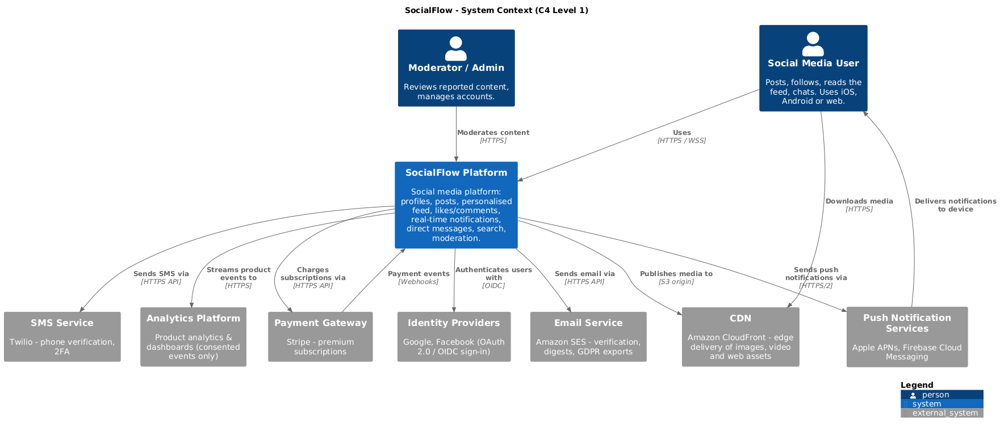
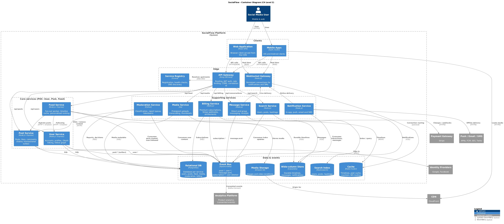
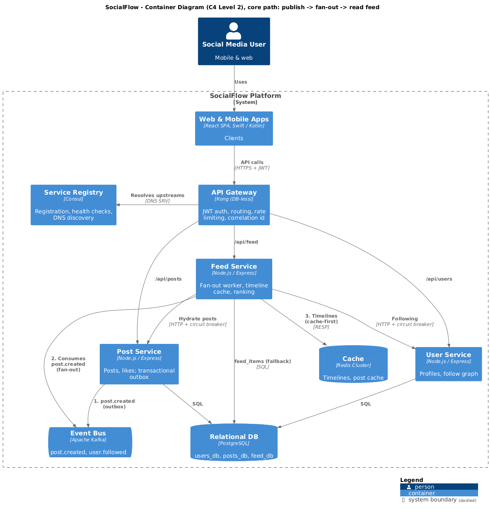
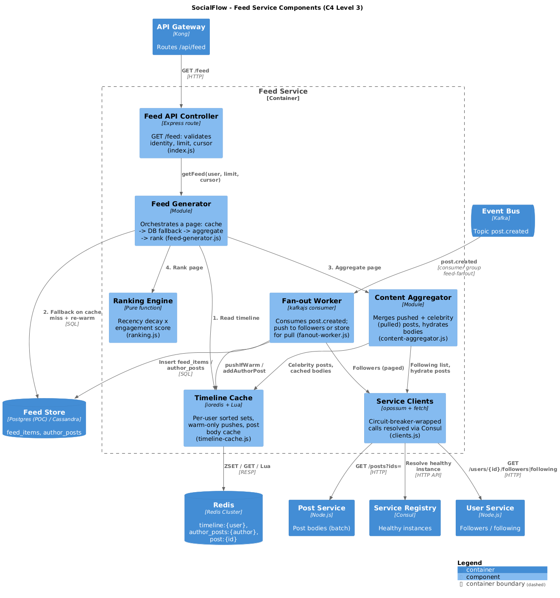

<!-- _class: lead -->
<!-- _paginate: false -->
<!-- _footer: '' -->

# SocialFlow
## Designing a scalable social media platform

**Lakshitha Wijerathne** · Engineer Track — Month 6 Capstone
System design · C4 architecture · Microservices POC

---

## 1 · Problem statement

<div class="cols">
<div>

**What we are building**
- Mobile-first social network
- Posts (text, images, video), follow graph
- Personalised **home feed**
- Likes, comments, shares
- Real-time notifications, DMs
- Search & content moderation

</div>
<div>

| Constraint | Target |
|---|---|
| Users | 1M MAU · 100K DAU · +50%/yr |
| Concurrency | 100K users |
| Feed load | **p95 < 200 ms** |
| Post publish | **p95 < 500 ms** |
| Availability | **99.9%** (43 min/month) |
| Data | No loss · GDPR |

</div>
</div>

> The hard part: a **read-heavy feed (100:1)** where some authors have millions of followers.

---

## Capacity estimation

| | Average | Design peak |
|---|---|---|
| Post writes | 500K/day → **6/s** | ~30/s |
| Reads | 50M/day → **580/s** | **~3,000/s** |
| Timeline inserts (×200 followers) | 100M/day → 1,200/s | ~6,000/s |
| Media storage | ~50–125 GB/day | **~20–45 TB/yr** (S3 + CDN) |
| Hot timelines in Redis | 100K active × 500 ids | **~5 GB** |

<span class="small">The brief says 1,000 rps peak, but 50M reads/day is already 580 rps on average, so I size for ~3,000 rps.</span>

**Takeaways:** writes are cheap, reads and fan-out dominate, and media is the biggest storage cost, so it goes straight to S3 and the CDN.

---

<!-- _class: diagram -->

## 2 · Architecture overview — C4 Level 1: System Context



---

<!-- _class: diagram -->

## C4 Level 2: Containers (all 20 containers)



---

## C4 Level 2: the core path the POC implements

<div class="cols">
<div>



</div>
<div>

1. **Publish:** Post Service writes the post and an **outbox** row in one transaction, then emits `post.created` to Kafka
2. **Fan-out:** Feed Service consumes it and pushes the post id into followers' **Redis** timelines
3. **Read:** `GET /api/feed` is **cache-first**, falls back to `feed_items`, hydrates posts behind a **circuit breaker**

Every call enters through **Kong** (JWT), and every upstream is found through **Consul**.

</div>
</div>

---

## Architecture in one slide

- **Edge:** CloudFront → ALB → **Kong** (JWT, rate limit, routing, correlation id)
- **Domain services**, each owns its data: User · Post · Feed · Notification · Message · Media · Search · Moderation
- **Sync** REST for request/response; **async Kafka events** for everything after the response:
  `post.created` → fan-out, search index, moderation, notifications, analytics
- **Storage per need:** Postgres (correctness) · Redis (speed) · Cassandra (append-heavy) · Elasticsearch · S3
- **Discovery:** Consul — self-registration + health checks; Kong resolves via Consul DNS

| Decision | Instead of | Why |
|---|---|---|
| Microservices | Monolith | Different scaling & failure profiles |
| Kafka + outbox | Dual write / RabbitMQ | Durable, replayable, no lost events |
| Hybrid fan-out | Pure push / pull | Fast reads, no celebrity write storms |

---

## 3 · Deep dive: the Feed Service — hybrid fan-out

<div class="cols">
<div>

**Push** for normal authors (≤ 10K followers)
→ write post id into each follower's timeline
→ read = **one Redis `ZREVRANGE`**

**Pull** for celebrities (> 10K followers)
→ store once in `author_posts`
→ merged into readers' feeds at read time

**Warm-only pushes**
→ Redis updated only for active users
→ cold timelines rebuilt from durable store

</div>
<div>

| | Read | Write |
|---|---|---|
| Pull | ❌ N queries | ✅ 1 |
| Push | ✅ 1 query | ❌ 1M for celebs |
| **Hybrid** | ✅ 1 + few | ✅ bounded |

**Trade-offs accepted**
- More complex read path (merge + dedupe)
- Eventual consistency: fan-out lag target p95 < 5 s
- Durable timelines grow fast → TTL 30 days, Cassandra

</div>
</div>

---

<!-- _class: diagram -->

## C4 Level 3: Feed Service components



---

## Feed read path — staying under 200 ms

<div class="cols">
<div>

1. **Timeline Cache** — Redis ZSET (~2 ms)
2. *Miss* → `feed_items` + async re-warm
3. **Content Aggregator** — merge celebrity posts
4. Hydrate 20 posts in **one batch call** — behind a **circuit breaker**
5. **Ranking Engine** (personalised)
   recency × engagement × **affinity(reader, author)** × type preference
6. Opaque cursor → stable mobile paging

</div>
<div>

| Step | Budget |
|---|---|
| Kong | 5 ms |
| Redis timeline | 2 ms |
| Celebrity pulls | 5 ms |
| Hydration | 20 ms |
| Rank + serialise | 5 ms |
| **Server total** | **≈ 40 ms** |

Measured in the POC (laptop, through Kong):
<span class="ok">p50 ≈ 23 ms · p95 ≈ 41 ms</span>
<span class="small">feed-service internal p95 ≈ 25 ms</span>

</div>
</div>

---

## 4 · Scalability strategy

<div class="cols">
<div>

**Horizontal scaling**
- Stateless services + HPA; scale-out needs **no gateway change** (Consul DNS)
- Kafka consumers scale to partition count
- WebSocket tier: ~25K connections/node

**Caching tiers**
- CDN for media (> 95% hit)
- Redis: timelines, post bodies, follow lists
- Event-driven invalidation + TTL safety net

</div>
<div>

**Database scaling path**
1. Primary + sync standby + read replicas
2. PgBouncer, partition `posts` by month; timelines/DMs → Cassandra
3. **Shard by user/author id** (64 logical shards), Snowflake ids

**At 10× (10M MAU, ~30K rps)**
Same shape, more capacity: Redis 10–15 shards, 48 partitions, active-active EU/US.

</div>
</div>

---

## Reliability — designing for failure

| Failure | What happens | Mechanism |
|---|---|---|
| Post Service down | Feed still served from cached post bodies (`degraded: true`) | **Circuit breaker** + fallback |
| Redis down / evicted | Feed served from durable store, re-warmed | Cache-aside |
| Kafka down at publish | Post saved; event published later | **Transactional outbox** + relay |
| User Service down | Fan-out pauses, nothing lost | Kafka retry, idempotent consumer |
| Instance dies | Removed from routing in ≤ 5 s | Consul health checks |
| Consul loses state | Instances re-register themselves | Registration watchdog |

**CAP per domain:** accounts / posts → **CP** · feeds, counters, notifications → **AP**
**GDPR:** export & erasure via `user.deleted` events, crypto-shredding, EU residency

---

## 5 · Demo — working microservices

```text
docker compose up -d --build          # Kong, Consul, Kafka, Postgres, Redis + 3 services
docker compose up -d --scale post-service=2
node scripts/demo.mjs --chaos
```

<div class="cols">
<div>

**What you will see**
1. 3 services registered & healthy in Consul
2. Users, follows, posts through **Kong** (JWT: no token → 401)
3. Kafka fan-out → feed `source: db` → `cache`
4. Celebrity post **pulled** at read time
5. Redis key deleted → DB fallback
6. Load balanced across 2 post-service replicas

</div>
<div>

**Chaos: stop post-service**
```text
req 1-4  200 OK degraded=true  CLOSED
req 5    200 OK degraded=true  OPEN
req 6-7  200 OK degraded=true  OPEN (rejected fast)
restart → breaker CLOSED, degraded=false
```
<span class="small">14 unit tests: ranking, cursors, fan-out push/pull, breaker behaviour, JWT verification</span>

</div>
</div>

---

## Summary

- **Requirements first:** 100:1 reads, celebrity skew, < 200 ms feed, 99.9% availability
- **Hybrid fan-out** + Redis timelines are the core of the design
- **Events (Kafka + outbox)** decouple the 500 ms publish path from fan-out, search, moderation
- **Every dependency can fail** without taking the feed down: breakers, fallbacks, cache-aside
- **POC proves the patterns:** Kong gateway with JWT auth, Consul discovery, circuit breakers, Kafka fan-out
- **Scales 10× without changing shape**, only capacity and storage engines

<br>

**Artifacts:** design doc · C4 L1–L3 (draw.io + PNG) · 6 ADRs · POC repo

---

<!-- _class: lead -->
<!-- _paginate: false -->

# 6 · Questions?

**Why Kafka over RabbitMQ? · Why not pure push? · How do you handle unfollows? · What breaks first at 10×?**

Lakshitha Wijerathne · Thank you
